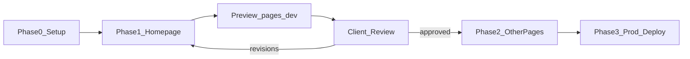

# SEPTNET Engineering Inc. — Handoff Note

**Project:** SEPTNET corporate static website  
**Workspace:** `c:\my_projects\allenkingsley`  
**Domain (prod, do not publish without approval):** https://septnetengineering.com  
**Last plan source:** SEPTNET Master Plan (reviewed + Auto Mode)  
**Handoff date:** 2026-11-09

This file saves the master plan decisions and current implementation status so the next agent/developer can continue without re-discovery.

---

## 1. Current status (what is already done)

| Item | Status |
|------|--------|
| Vite + React + TypeScript + Tailwind scaffold | Done |
| Homepage (full sections) | Done |
| Supporting pages: About, Services, Projects, Insights, Contact | Done |
| Centralized content/config | Done |
| placehold.co image config | Done |
| SEO (meta/OG, robots, sitemap, JSON-LD) | Done |
| Cloudflare SPA fallback (no catch-all `_redirects`) | Done |
| `npm run build` → `dist/` | Succeeds |
| Local preview/dev | Works (`npm run dev` / `npm run preview`) |
| Cloudflare `*.pages.dev` preview deploy | Not completed (needs `CLOUDFLARE_API_TOKEN` / dashboard access) |
| Production domain publish | **Not done — requires client approval** |
| Client homepage visual approval | Pending client feedback |
| Home v2 with client assets (logo, real photos, Approach section, self-hosted font) | Done 2026-11-09 — Lighthouse 95/100/100/100 |
| Cloudflare deploy method | GitHub auto-deploy (client repo + Cloudflare Pages Free) — see DEPLOYMENT.md |

### Run locally

```bash
npm install
npm run dev
```

Production-like preview:

```bash
npm run build
npm run preview
```

---

## 2. Master plan summary (locked decisions)

### Goal

Modern static corporate website for SEPTNET Engineering Inc. on **Cloudflare Pages**.  
Not WordPress. No backend, auth, forms backend, DB, or payments.

### Workflow rule (important)

Original plan: homepage first → client review → then other pages.  
During implementation, supporting pages were also built so the full shell is ready.  
Still treat **client visual approval** and **prod domain publish** as hard gates.

### Tech stack (fixed)

- React + TypeScript + Vite
- Tailwind CSS
- React Router (`BrowserRouter`)
- Lucide React
- Native CSS transitions + Intersection Observer scroll reveal
- Output: `dist/`

**Do not use:** Next.js, WordPress, Laravel, GSAP, Framer Motion, backend/API/DB, autoplay video.

### Cloudflare Pages settings

```text
Framework preset: Vite
Build command: npm run build
Build output directory: dist
Node version: 20.x
```

SPA routing: no catch-all `_redirects` rule (Cloudflare rejects `/* /index.html 200` as infinite loop). Rely on Pages built-in SPA fallback when `404.html` is absent.

### Design system (locked)

```css
--navy: #07182b;
--navy-dark: #03101f;
--blue: #0789ff;
--blue-hover: #086be8;
--white: #ffffff;
--light-bg: #f7f9fc;
--text-dark: #172338;
--text-muted: #607087;
--border: #dfe7f1;
```

- Font: **Plus Jakarta Sans** (not Inter)
- Animations: hover + fade-in-up only; respect `prefers-reduced-motion`
- Images: client photos (optimized WebP in `src/assets/images`) via `src/config/assets.ts`; placehold.co remains ONLY for the Projects page until client supplies project content
- Shell/Marlink/Thuraya-branded and AI-enhanced photos are intentionally NOT used until client confirms
- Remove/avoid: “Talk to an Engineer”, broken icons, tiny logo

### Content lock

- Display name (current): **SEPTNET Engineering Inc.**
- Primary services:
  1. Network Architecture & Design
  2. Firewall & Network Security
  3. SD-WAN & Secure Connectivity
  4. Implementation, Optimization & Support
- Email: `info@septnetengineering.com`
- Address: 1B Adebayo Doherty Street (Road 14), Off Admiralty Way, Lekki Phase 1, Lagos, Nigeria
- Contact method: **mailto only** (no nonfunctional form)
- Do **not** invent projects, articles, stats, certifications, or unverified claims
- Live site has alternate “consulting” copy / “Services” naming — screenshot + meeting brief are primary until client confirms

### Auto Mode rules for future agents

Decide yourself (do not ask repeatedly):

- spacing, icon choices, hover details, placeholder URLs
- keep mailto contact
- keep Insights empty-state until real content exists
- fix build/lint errors and continue

Stop / ask user only for:

1. Client review feedback incorporation after share
2. Publishing to `septnetengineering.com`
3. Replacing placeholders when client assets arrive

Preferred model for UI polish: **Claude Opus 5 High**  
Avoid Fast/Mini-only passes for homepage visuals.

---

## 3. Project structure (implemented)

```text
src/
  assets/logo/septnet-logo.png
  components/
    layout/     Header, Footer, MobileMenu, Layout
    ui/         Button, Container, SectionHeading, ServiceCard, ProjectCard, ScrollReveal
    sections/   Hero, ServiceHighlights, AboutSection, ServicesSection,
                SolutionsSection, ProjectsSection, InsightsPlaceholder, ContactCTA
    seo/        Seo, OrganizationJsonLd
  config/       assets.ts, site.ts, navigation.ts, seo.ts
  data/         services.ts, projects.ts, insights.ts
  pages/        Home, About, Services, Projects, Insights, Contact
  App.tsx
  main.tsx
  index.css
public/
  _redirects
  robots.txt
  sitemap.xml
  favicon.png
CLIENT_CONTENT_REQUIRED.md
CLIENT_REVIEW_CHECKLIST.md
DEPLOYMENT.md
HANDOFF.md          ← this file
README.md
```

### Routes

- `/` Home
- `/about`
- `/services`
- `/projects`
- `/insights`
- `/contact`

Navigation currently uses real routes (phase-2 style), with service deep-links like `/services#service-architecture`.

---

## 4. Where to edit content

| What | File |
|------|------|
| Company name, hero, about, contact copy | `src/config/site.ts` |
| Images / placeholders | `src/config/assets.ts` |
| Nav links | `src/config/navigation.ts` |
| SEO titles/descriptions | `src/config/seo.ts` |
| Services + solutions | `src/data/services.ts` |
| Projects | `src/data/projects.ts` |
| Insights | `src/data/insights.ts` |

---

## 5. Homepage section order (implemented)

1. Header (large logo, services dropdown, Contact mailto, mobile menu)
2. Hero (static bg, dark overlay, blue accent headline, CTAs)
3. Service highlights (4 Lucide icons)
4. About
5. Services cards
6. Solutions / Expertise
7. Projects (placeholder cards)
8. Insights empty-state
9. Contact CTA (mailto)
10. Footer

---

## 6. Next actions for handoff owner

1. Share local/Cloudflare preview + `CLIENT_REVIEW_CHECKLIST.md` with client (KING)
2. Collect feedback (max ~2 revision rounds on visuals/copy)
3. Confirm legal name: **Inc.** vs **Services**
4. Replace placeholders when client sends images/content (`CLIENT_CONTENT_REQUIRED.md`)
5. Deploy preview to Cloudflare Pages (`DEPLOYMENT.md`) using client account token/dashboard
6. Only after approval: attach custom domain `septnetengineering.com`

### Cloudflare preview deploy (needs token)

```bash
npm run build
# PowerShell
$env:CLOUDFLARE_API_TOKEN="your_token_here"
npx wrangler pages deploy dist --project-name=septnet-engineering
```

---

## 7. Related docs in this repo

- `README.md` — quick start
- `DEPLOYMENT.md` — Cloudflare Pages instructions
- `CLIENT_CONTENT_REQUIRED.md` — missing client assets
- `CLIENT_REVIEW_CHECKLIST.md` — client approval checklist

---

## 8. Original plan flow



**Bottom line for next person:** Codebase is buildable and page-complete with placeholders. Do not invent client content. Do not publish production DNS/domain without explicit approval. Focus next on client review + asset replacement + Cloudflare preview/prod under their account.
